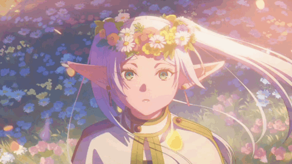

  

  
  
  

<h2 align="center">🌸 ~ About me ~ 🌸</h2>

- **Name:** Awan Smith
- **From:** China
- **Loves:** Web3, AI, open source, technical writing
- **Exploring:** smart contracts, on-chain ecosystems, AI × decentralized systems
- **Research:** deep learning, neural networks, quantitative trading
- **Education:** [Jiangsu University](https://www.ujs.edu.cn/) · Intelligent Science and Technology · 2022 – 2026 🎓

 

<h2 align="center">🔮 ~ Knowledge ~ 🔮</h2>

  

  
  
  
  
  

<h2 align="center">✨ ~ Current quests ~ ✨</h2>

- [x] 🎓 Graduated from Jiangsu University (July 2026)
- [ ] 📈 Building a machine learning-based quantitative trading system (in progress)
- [ ] 💼 Open to work: Web3 / AI roles, feel free to reach out

 

<h2 align="center">📊 ~ Stats ~ 📊</h2>

  
  

<picture>
  <source media="(prefers-color-scheme: dark)" srcset="https://raw.githubusercontent.com/gunksd/gunksd/output/github-contribution-grid-snake-dark.svg">
  
</picture>

More metrics

<h3 align="center">💖 ~ Thanks for reading! ~ 💖</h3>

